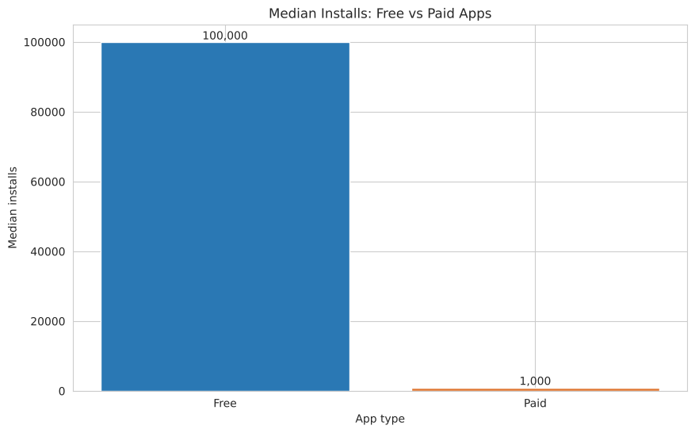
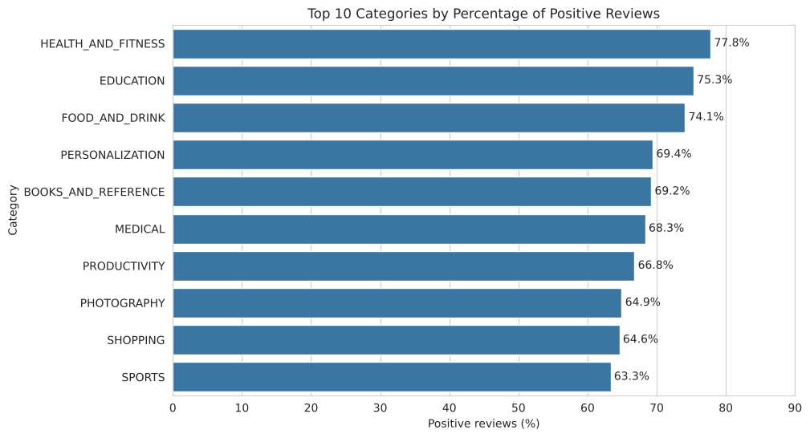
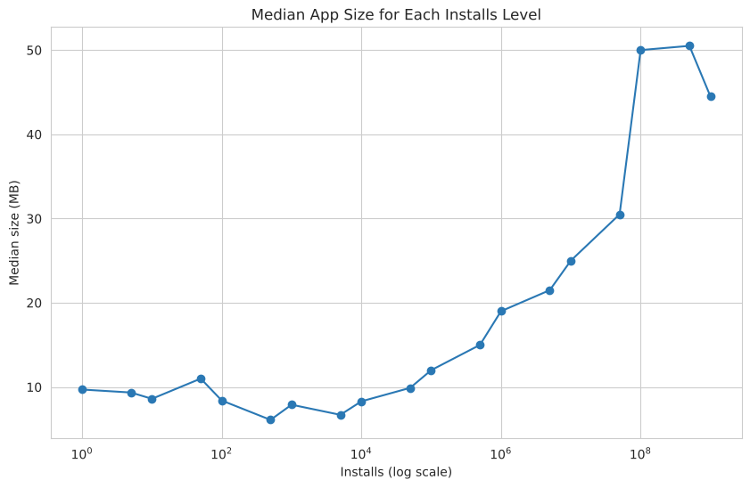

# What Makes a Google Play App Successful?

Exploratory data analysis of Google Play Store apps using Python, Pandas, NumPy, Matplotlib and Seaborn.

## Goal
Explore how category, type (free or paid), price, size, and last update date relate to app installs and ratings, to help developers decide what kind of new app to build.

## Questions
1. Which category has the highest average rating?
2. Do free apps have more installs than paid apps on average?
3. Do apps updated more recently have higher average ratings?
4. Which category has the highest percentage of positive reviews?
5. Is there a relationship between app size and number of installs?

## Data
- **Source:** L. Gupta, "Google Play Store Apps," Kaggle, 2019 — https://www.kaggle.com/datasets/lava18/google-play-store-apps
- **License:** CC BY-SA 4.0
- `googleplaystore.csv`: 10,841 rows, 13 columns (one row per app)
- `googleplaystore_user_reviews.csv`: 64,295 rows, 5 columns (one row per review)
- The data was collected in August 2018.

## Cleaning steps
- Dropped one broken row (index 10472) whose values were shifted to the wrong columns.
- Kept 1,474 missing ratings as NaN (filling them would create fake ratings).
- Filled the one missing `Type` with "Free" because its price is 0.
- Removed 483 fully duplicated rows and 698 duplicated app names (kept the row with the most reviews).
- Converted `Reviews`, `Installs`, `Price` and `Size` to numbers, and `Last Updated` to a date.
- Checked price outliers with IQR: the upper limit was 0, so clipping was not used ("I am rich" apps are real).
- In the reviews table: removed rows without sentiment and 7,735 duplicated reviews.
- Result: 9,659 unique apps and 29,697 reviews, saved in `data/clean/`.

## Key findings
1. **Free apps get many more installs:** median 100,000+ for free apps vs 1,000+ for paid apps. Paid apps are only 7.8% of the store.
2. **Ratings are high everywhere:** average 4.17. EVENTS has the highest average rating (4.44), but the top 10 categories are close (4.24–4.44).
3. **Recently updated apps rate higher:** 4.23 for apps updated in 2018 vs about 4.03–4.09 for 2013–2017.
4. **Health & Fitness has the happiest users:** 77.8% positive reviews, then Education (75.3%) and Food & Drink (74.1%). Social and Game are the lowest (about 55–59%).
5. **Popular apps are bigger:** the correlation is weak (0.13), but the median size grows from about 8 MB to about 50 MB for apps with 100 million+ installs.





## Recommendations
- Start with a free app to reach more users.
- Consider categories with happy users like Health & Fitness, Education and Books.
- Update the app regularly.

## Limitations
- Data is from 2018; installs are ranges, not exact numbers.
- The reviews file covers only about 800 apps.
- Results show relationships, not cause and effect.

## Project structure
```
MyProject/
├── data/
│   ├── raw/          original data (not changed)
│   └── clean/        cleaned data
├── images/           saved charts
├── project.ipynb     the full analysis
├── requirements.txt
└── README.md
```

## How to run
```bash
python -m venv .venv
.venv\Scripts\activate        # Windows
pip install -r requirements.txt
```
Then open `project.ipynb` in VS Code or Jupyter and choose **Run All**.

## Tools
Python, Pandas, NumPy, Matplotlib, Seaborn, Jupyter, Git and GitHub.

## Author
Ahmed Al-Qahtani — AI and Robotics Engineering student
